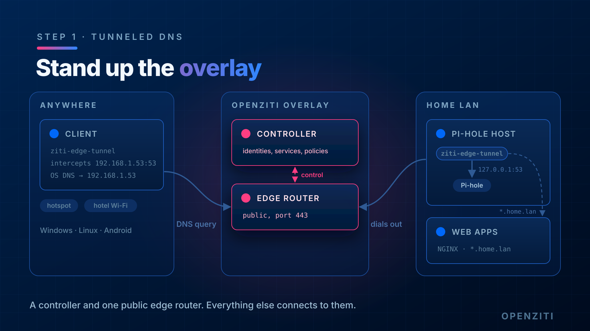

# Step 1: Set up your overlay network



You need two things before anything else: a **controller** (the brain: identities, services, policies) and at least
one **public edge router** (the thing clients connect to). Both need to be reachable from wherever your clients will
be, so in practice that means a public address or a port forward.

## What we use in this lab

- Controller: `ctrl.example.com:8441` (also answers as
  `ec2-203-0-113-10.us-east-2.compute.amazonaws.com:8441`), ziti v2.0.0
- ZAC: `https://ctrl.example.com:8441/zac`
- Edge router: `edge-router-1`, port 8442, role attribute `public`
- Everything we create for this lab is named `dnslab-*` so it's easy to find and delete later.

## If you're building your own

The quickest path is the quickstart on a Linux box with a public IP. It stands up a controller and one edge router.
See the OpenZiti docs quickstart for the current command for your platform.

## Check it works

Log in with the CLI (or open ZAC and log in as admin):

```
ziti edge login <controller-host>:<port> -u admin -p <password>
```

The edge router is online:

```
ziti edge list edge-routers
```

You want `ONLINE` = `true` and the `public` attribute on it.

The default policies exist. The quickstart creates these two. If they're missing, nothing connects, even when your
services and service policies look right.

```
ziti edge list edge-router-policies          # want one like: #public routers <-> #all identities
ziti edge list service-edge-router-policies  # want one like: #all services <-> #all routers
```

On this lab network those are `allEdgeRouters` and `allSvcAllRouters`.

## Done when

- [x] Controller answers and you can log in
- [x] At least one edge router shows online
- [x] Default edge router policy and service edge router policy exist
