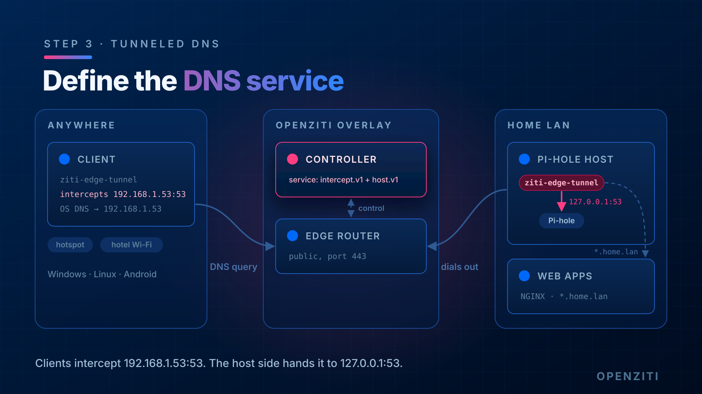

import TabItem from '@theme/TabItem';
import { AdminToolTabs, ThemedScreenshot } from '../../_imports';

# Step 3: Create the DNS service



A service is two halves, each a **config**:

- **[intercept.v1](../../reference/config-types/intercept_v1.md)**: what the *client* grabs. Here: anything sent to
  the Pi-hole's IP on port 53, TCP or UDP.
- **[host.v1](../../reference/config-types/host_v1.md)**: where the *hosting* identity sends it. The tunneler runs on
  the Pi-hole itself, so that's `127.0.0.1:53`.

The client keeps using `192.168.1.53` as its DNS server whether it's at home or not. The tunneler on the client
captures that traffic and carries it over the overlay, and the Pi-hole's tunneler hands it to Pi-hole locally.

Pi-hole will see every overlay query as coming from `127.0.0.1`, not from the real client. Its per-client stats and
per-client blocking groups won't tell overlay clients apart. That's the trade-off of hosting with a tunneler.

`forwardProtocol` tells the host side to use whichever protocol the client used (UDP for normal lookups, TCP for big
answers), instead of a single fixed one.

## Create the configs and the service

<AdminToolTabs>
<TabItem value="cli" label="ziti CLI">

```text
ziti edge create config dnslab-dns-intercept intercept.v1 \
  '{
    "protocols": ["tcp", "udp"],
    "addresses": ["192.168.1.53"],
    "portRanges": [{"low": 53, "high": 53}]
  }'

ziti edge create config dnslab-dns-host host.v1 \
  '{
    "address": "127.0.0.1",
    "port": 53,
    "forwardProtocol": true,
    "allowedProtocols": ["tcp", "udp"]
  }'

ziti edge create service dnslab-dns \
  --configs dnslab-dns-intercept,dnslab-dns-host \
  --role-attributes dnslab-dns
```

</TabItem>
<TabItem value="zac" label="ZAC">

Under **Services**, click **+** and choose **Create Advanced Service**. Name it `dnslab-dns` and give it the attribute
`dnslab-dns`.

Under **Add Configurations**, create each config with the form fields, then click **Create and Attach**. Use the form,
not the JSON view: ZAC rejects a config pasted as JSON.

First the `intercept.v1` config, `dnslab-dns-intercept`:

<ThemedScreenshot src="/img/tunneled-dns/zac-dns-intercept.png" width={500} alt="The dnslab-dns-intercept config in ZAC: port range 53, address 192.168.1.53, protocols TCP and UDP."/>

Then the `host.v1` config, `dnslab-dns-host`. Turn on **Forward Protocol** and check TCP and UDP under **Allowed
Protocols**:

<ThemedScreenshot src="/img/tunneled-dns/zac-dns-host.png" width={500} alt="The dnslab-dns-host config in ZAC: address 127.0.0.1, port 53, Forward Protocol on, allowed protocols TCP and UDP."/>

Save the service.

</TabItem>
</AdminToolTabs>

The `dnslab-dns` attribute is what the policies in [step 4](./04-policies.mdx) match on.

## Check it works

```text
ziti edge list services 'name="dnslab-dns"'
ziti edge list configs 'name contains "dnslab-dns"'
```

Nothing carries traffic yet. With no policies, no identity may host or use the service.

## Done when

- Both configs exist
- `dnslab-dns` service exists with both configs and the `dnslab-dns` attribute
