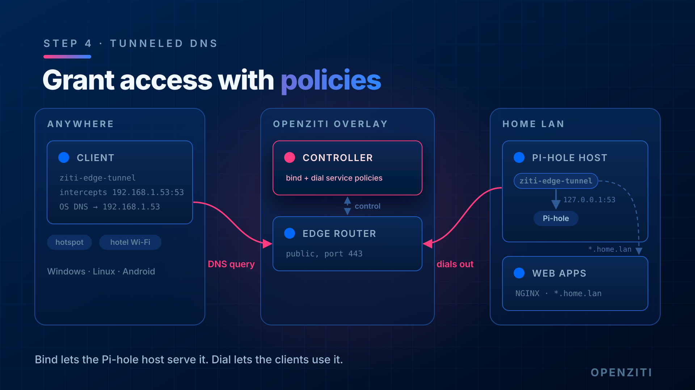

import TabItem from '@theme/TabItem';
import { AdminToolTabs, ThemedScreenshot } from '../../_imports';

# Step 4: Grant access with policies



A service does nothing until
[service policies](../../learn/core-concepts/security/authorization/policies/overview.mdx#service-policies)
say who may use it. There are two kinds:

- **Bind**: who may *host* the service (the Pi-hole's tunneler).
- **Dial**: who may *use* it (the clients).

Both match on attributes, so neither policy names an identity directly.

## Create the policies

<AdminToolTabs>
<TabItem value="cli" label="ziti CLI">

```text
ziti edge create service-policy dnslab-dns-bind Bind \
  --service-roles '#dnslab-dns' \
  --identity-roles '#dnslab-hosts'

ziti edge create service-policy dnslab-dns-dial Dial \
  --service-roles '#dnslab-dns' \
  --identity-roles '#dnslab-clients'
```

</TabItem>
<TabItem value="zac" label="ZAC">

Under **Policies > Service Policies**, add a Bind policy `dnslab-dns-bind` for `#dnslab-dns` and `#dnslab-hosts`:

<ThemedScreenshot src="/img/tunneled-dns/zac-dns-bind-policy.png" width={500} alt="The dnslab-dns-bind service policy in ZAC: type Bind, service attribute #dnslab-dns, identity attribute #dnslab-hosts."/>

Then add a Dial policy `dnslab-dns-dial` the same way, for `#dnslab-dns` and `#dnslab-clients`.

</TabItem>
</AdminToolTabs>

No identity has `dnslab-clients` yet. [Step 5](./05-client.mdx) tags the client with it.

Don't give the Pi-hole identity Dial on this service. If it could dial, its own tunneler would intercept traffic to
`192.168.1.53:53` on the Pi-hole itself and loop it through the overlay.

## The other two policies

Two more policy types,
[edge router policies](../../learn/core-concepts/security/authorization/policies/overview.mdx#edge-router-policies)
and
[service edge router policies](../../learn/core-concepts/security/authorization/policies/overview.mdx#service-edge-router-policies),
decide which edge routers identities and services may use. The quickstart's defaults (`#public` routers for `#all`
identities, `#all` services on `#all` routers) already cover the lab, so there's nothing to add here. If you removed
those defaults, add an edge router policy and a service edge router policy for `#dnslab-*` now.

## Check it works

The
[policy advisor](../../learn/core-concepts/security/authorization/policies/overview.mdx#policy-advisor)
checks every link in the chain for one identity and one service:

```text
ziti edge policy-advisor services -q dnslab-dns dnslab-pihole
```

You want `OKAY` with Bind permission. On the Pi-hole, the tunneler picks up the new service within a few seconds:

```text
sudo journalctl -u ziti-edge-tunnel --since "2 min ago" | grep dnslab-dns
```

Look for `hosting server_address[tcp:127.0.0.1:53] service[dnslab-dns]` and `bound successfully`.

On the controller, the service now has a terminator. That's the record of "someone is hosting this":

```text
ziti edge list terminators 'service.name="dnslab-dns"'
```

## Done when

- Bind and Dial policies exist
- policy-advisor says `OKAY` for `dnslab-pihole` on `dnslab-dns`
- A terminator exists for `dnslab-dns`
