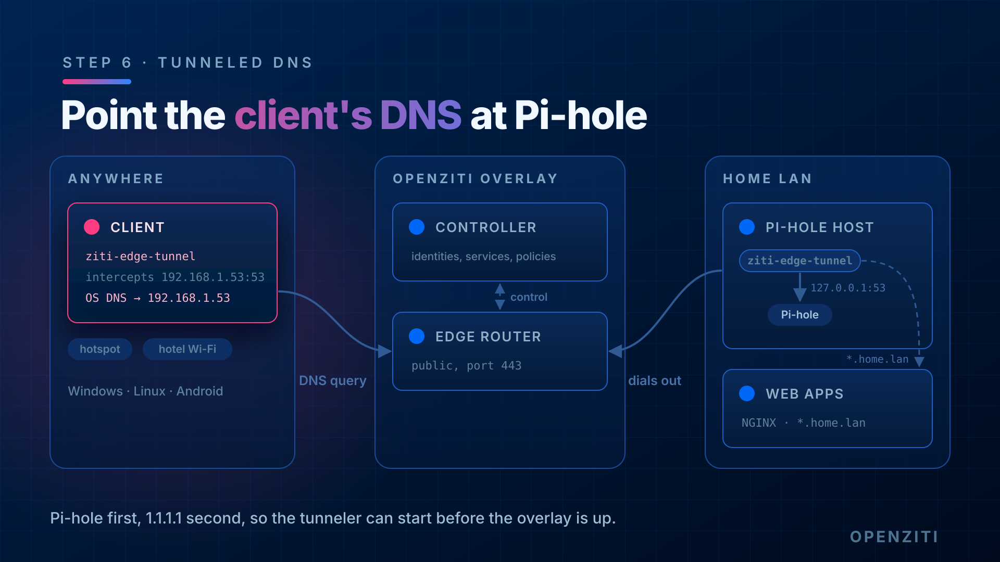

# Step 6: Point the client's DNS at the Pi-hole



Step 5 proved the overlay path to `192.168.1.53:53` works. Now make the OS use it for every lookup.

## The fallback trade-off

Use the Pi-hole as the primary DNS server and a public resolver (`1.1.1.1`) as the secondary. The secondary is what
saves you from the chicken-and-egg problem: away from home, the tunneler has to resolve the controller and router
names *before* the overlay is up, and the Pi-hole is unreachable until then.

The cost: OSes don't treat "secondary" as "only when the primary is dead". Windows in particular will sometimes ask
the secondary anyway, and those answers aren't filtered. So expect the odd ad to slip through.

The stricter option is to drop the secondary and put the controller and router names in the client's hosts file
instead. Then every lookup goes to the Pi-hole and the tunneler can still start. The catch: if those IPs ever change,
the client can't connect until you update the hosts file. Do the fallback version first and try the strict one in
step 8.

## Windows

Some commands below need an **admin** PowerShell and some don't. Each code block starts with a comment saying which.

- **Normal PowerShell**: any PowerShell window.
- **Admin PowerShell**: `Win+X` -> **Terminal (Admin)**, and accept the UAC prompt. The window title says
  "Administrator". If a command that needs admin runs in a normal window, it fails with
  `Access to a CIM resource was not available to the client` (or `Access is denied`) and changes nothing.

### 1. Snapshot first

Save how DNS looks now, so you can put it back exactly:

```
# normal PowerShell
$snap = "$HOME\dns-before-ziti"
New-Item -ItemType Directory -Force $snap | Out-Null
netsh interface ipv4 show dnsservers  > "$snap\dnsservers-v4.txt"
netsh interface ipv6 show dnsservers  > "$snap\dnsservers-v6.txt"
ipconfig /all                         > "$snap\ipconfig-all.txt"
Get-DnsClientNrptRule | Format-List   > "$snap\nrpt.txt"
Get-NetRoute | Format-Table -AutoSize > "$snap\routes.txt"
Copy-Item C:\Windows\System32\drivers\etc\hosts "$snap\hosts"
```

Open `dnsservers-v4.txt` and look for your Wi-Fi/Ethernet adapter. It says either **"DNS servers configured through
DHCP"** (the normal case: your router hands them out) or **"Statically Configured DNS Servers"** (someone typed them
in). That one line decides how you undo this.

### 2. Make the change

Get the adapter name. Use the physical adapter (Wi-Fi or Ethernet), not `ziti-tun0`:

```
# normal PowerShell
Get-NetAdapter | Where-Object Status -eq Up
```

Set the DNS servers:

```
# ADMIN PowerShell
Set-DnsClientServerAddress -InterfaceAlias "Wi-Fi" -ServerAddresses 192.168.1.53,1.1.1.1
Clear-DnsClientCache
```

Confirm it took:

```
# normal PowerShell
netsh interface ipv4 show dnsservers name="Wi-Fi"
```

Expect **"Statically Configured DNS Servers: 192.168.1.53, 1.1.1.1"**. If it still says "configured through DHCP",
the admin step didn't run elevated.

Don't count on the setting following you to other Wi-Fi networks. In testing, joining a phone hotspot replaced it
with the hotspot's DHCP DNS server, so lookups quietly skipped the Pi-hole. After you join a new network, check
again and rerun the `Set-DnsClientServerAddress` line if needed.

If name resolution breaks, put the adapter back on DHCP DNS:

```n# ADMIN PowerShell
Set-DnsClientServerAddress -InterfaceAlias "Wi-Fi" -ResetServerAddresses
```

## Linux

Get the interface name and its current DNS servers:

```
resolvectl status
```

### Quick and temporary (systemd-resolved)

Good for testing. It lasts until reboot or the next DHCP renewal:

```
sudo resolvectl dns enp0s3 192.168.1.53 1.1.1.1
sudo resolvectl flush-caches
```

Undo: `sudo resolvectl revert enp0s3`, then bounce the connection (`sudo nmcli connection down <name>; sudo nmcli
connection up <name>`). `revert` alone leaves the link with no DNS server.

systemd-resolved doesn't go back to the first server once it has switched. If the Pi-hole is slow or unreachable even
once (for example, before the tunneler connects), resolved moves to `1.1.1.1` and keeps using it. Your lookups then
come back unfiltered with no error. `resolvectl status enp0s3` shows which one it's using on the
`Current DNS Server:` line. To test that filtering works, list the Pi-hole by itself:

```
sudo resolvectl dns enp0s3 192.168.1.53
sudo resolvectl flush-caches
```

The first lookup after you change servers can take up to ~15 seconds. resolved first probes what the new server
supports (EDNS0, DNSSEC) and only then answers. After that, lookups over the overlay take well under a second.

### Permanent (NetworkManager)

```
nmcli connection show --active
sudo nmcli connection modify "<connection>" ipv4.dns "192.168.1.53 1.1.1.1" ipv4.ignore-auto-dns yes
sudo nmcli connection up "<connection>"
resolvectl status
```

`resolvectl status` should list `192.168.1.53` on the physical link. The `ziti0` link has its own entry for the
tunneler's resolver. That's expected: it only answers names you intercept.

## Android

Android only lets you set DNS per Wi-Fi network, not on mobile data. On a Wi-Fi network you control: Wi-Fi -> the
network -> edit -> IP settings: Static -> DNS 1 `192.168.1.53`, DNS 2 `1.1.1.1`. This lab didn't test that path.

On mobile data, the phone's own lookups are **not** filtered. Tested with Ziti Mobile Edge running on mobile data:

- `nslookup doubleclick.net 192.168.1.53` (Termux, `pkg install dnsutils`) returns `0.0.0.0`. The overlay path to the
  Pi-hole works.
- `ping -c1 doubleclick.net` returns a real Google IP. Android's own resolver went to the carrier's DNS, not to the
  Pi-hole.
- Intercepted names still work: `https://app1.home.lan:8443/` from step 9 loads in Chrome.

So on Android you get your intercepted services everywhere, but Pi-hole filtering only on Wi-Fi networks where you set
the DNS by hand. Test with `ping`, not `nslookup` with no server: Termux's `nslookup` reads its own resolver file
instead of Android's.

## Check it works

Ask with no server argument, so the OS picks the server:

```
nslookup doubleclick.net
```

You want Pi-hole's block answer (`0.0.0.0`). On Windows and Linux, `nslookup` also prints which server answered. If
it's `1.1.1.1`, the OS skipped the primary.

Then check a name only your Pi-hole knows (a local DNS record on it) resolves too.

## Done when

- [x] Client OS uses `192.168.1.53` as primary DNS
- [x] A blocked domain returns `0.0.0.0` without naming the server
- [x] A Pi-hole local record resolves
