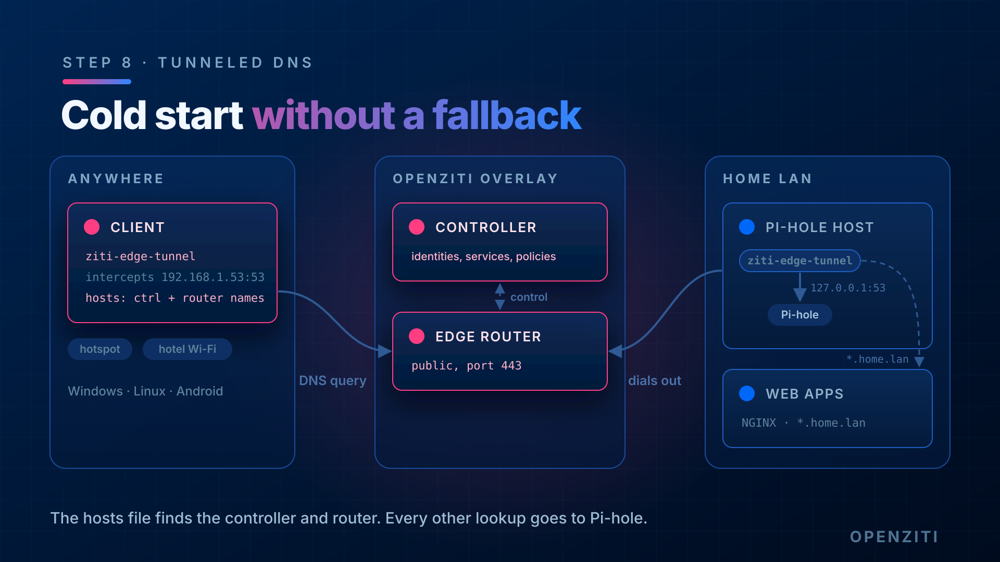

# Step 8: Cold start without a fallback resolver



[Step 6](./06-client-dns.md) kept `1.1.1.1` as a secondary so the tunneler can find the controller and routers
before the overlay is up. This step removes the secondary and shows why you need it. Then it fixes the problem a
stricter way: put the controller and router names in the hosts file, and send every other lookup to the Pi-hole.

Stay off your LAN for this step (same hotspot or VLAN as [step 7](./07-off-lan-test.md)).

## 1. Find the names the tunneler resolves at startup

The tunneler looks up two kinds of name before it can reach anything on the overlay:

- **The controller.** Ziti Desktop Edge shows it on the identity's detail page (`Network`). On Linux it's the
  `ztAPI` in the identity file. Use the name *from the identity*, not the one you browse to. A controller can
  answer to several names. Here the browser uses `ctrl.example.com`, but the identity uses
  `ec2-203-0-113-10.us-east-2.compute.amazonaws.com:8441`.
- **Every edge router the identity can use.** In ZAC: **Edge Routers**, and read the hostname in each router's
  address. The CLI's table leaves the address out, so ask for JSON:

  ```text
  # normal PowerShell
  ziti edge list edge-routers -j | ConvertFrom-Json | ForEach-Object data |
    Select-Object name, hostname, supportedProtocols | Format-List
  ```

  Here: `ec2-203-0-113-10.us-east-2.compute.amazonaws.com`.

Look up their IPs now, while the fallback still works, and write them down:

```text
# normal PowerShell
Resolve-DnsName ctrl.example.com -Type A
Resolve-DnsName ec2-203-0-113-10.us-east-2.compute.amazonaws.com -Type A
```

## 2. Remove the fallback

Windows:

```text
# ADMIN PowerShell
Set-DnsClientServerAddress -InterfaceAlias "Wi-Fi" -ServerAddresses 192.168.1.53
Clear-DnsClientCache
```

Linux:

```text
sudo resolvectl dns enp0s3 192.168.1.53
sudo resolvectl flush-caches
```

## 3. Cold-start the tunneler and watch it fail

Turning OpenZiti off and on in the app isn't enough, because the running service can reuse addresses it already
looked up. Restart the service so it starts from nothing:

```text
# ADMIN PowerShell
Get-Service ziti*
Restart-Service ziti
```

```text
# Linux
sudo resolvectl flush-caches
sudo systemctl restart --no-block ziti-edge-tunnel
```

On Linux, the restart itself can take 90 seconds while DNS is broken. The old tunneler doesn't exit on SIGTERM, so
systemd waits out its stop timeout and kills it (`State 'stop-sigterm' timed out. Killing.` in the journal).
`--no-block` gives you your shell back while that happens.

Give it a few seconds. **Expect it to fail**: the identity doesn't connect and no services show up. The tunneler
asks the Pi-hole for the controller's address, but the Pi-hole is only reachable through the overlay, which isn't up
yet.

Confirm the cause:

```text
# normal PowerShell
nslookup ec2-203-0-113-10.us-east-2.compute.amazonaws.com
```

It times out against `192.168.1.53`.

On Linux, the tunneler log shows it too:

```text
sudo journalctl -u ziti-edge-tunnel --since -2min --no-pager -l | grep -E "ERROR|connected to controller"
```

Look for `failed to configure OIDC[...] (no more URLs to try): -110/connection timed out`. If you skipped the
cache flush, the tunneler can get one step further on a cached address and report `connected to controller`
before it fails anyway.

## 4. Fix it with the hosts file

Add the IPs from [part 1](#1-find-the-names-the-tunneler-resolves-at-startup). Windows, in an admin editor (`notepad`
from the admin PowerShell):

```text
# ADMIN PowerShell
notepad C:\Windows\System32\drivers\etc\hosts
```

Linux: `sudo nano /etc/hosts`.

Add one line per name. Here the controller and the router share a name, so one line covers both:

```text
203.0.113.10  ec2-203-0-113-10.us-east-2.compute.amazonaws.com
```

Then restart the tunneler again (the commands in [part 3](#3-cold-start-the-tunneler-and-watch-it-fail)). This time
it connects, because the OS answers those names from the hosts file without asking any DNS server. On Linux, the log
shows `authorization successful` and `router edge-router-1 connected` within a couple of seconds.

On Linux, the first lookups after the restart can fail with `REFUSED`. Each link gets its own DNS server, and
`ziti0` (the tunneler's resolver at `100.64.0.2`) refuses every name it doesn't intercept, instantly. If
systemd-resolved is still re-checking the Pi-hole after the outage, the refusal is the only answer it gets in time.
Wait a few seconds and ask again. To see each path on its own:

```text
resolvectl query -i enp0s3 doubleclick.net
resolvectl query -i ziti0 doubleclick.net
```

The first should return `0.0.0.0`. The second returns `REFUSED`, and that's expected.

Check that everything else still goes through the Pi-hole:

```text
nslookup doubleclick.net
nslookup pi.hole
```

Expect `0.0.0.0` for the first and a `pi.hole` answer for the second, both from `192.168.1.53`.

## The trade-off

Now every lookup goes to the Pi-hole, so nothing slips past the filter. The cost is that the hosts file is a
hardcoded copy of the controller and router IPs. If they change (a new cloud VM, a dynamic IP, an added router), the
client can't connect until you update the hosts file on every device. With a fallback resolver, that doesn't happen.
In exchange, the fallback occasionally answers a lookup the Pi-hole should have filtered.

Pick one per device. On a laptop you manage yourself, the hosts file is easy to keep up to date. On a family member's
phone, keep the fallback.

## Undo

Put the [step 6](./06-client-dns.md) setting back and remove the hosts lines if you're not keeping them:

```text
# ADMIN PowerShell
Set-DnsClientServerAddress -InterfaceAlias "Wi-Fi" -ServerAddresses 192.168.1.53,1.1.1.1
Clear-DnsClientCache
```

```text
# Linux
sudo resolvectl dns enp0s3 192.168.1.53 1.1.1.1
```
## Done when

- With only `192.168.1.53` as DNS and no hosts entries, a restarted tunneler fails to connect
- With hosts entries for the controller and routers, a restarted tunneler connects
- `nslookup doubleclick.net` returns `0.0.0.0` from `192.168.1.53`
