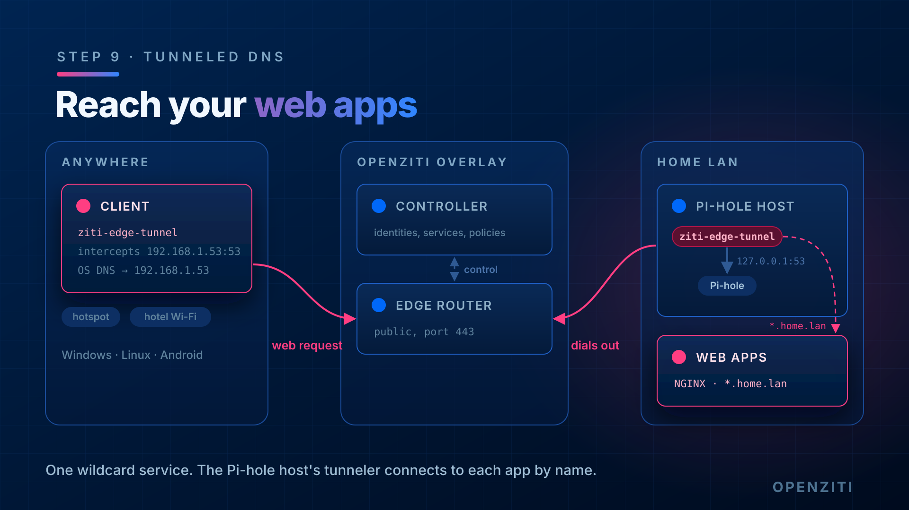

import TabItem from '@theme/TabItem';
import { AdminToolTabs, ThemedScreenshot } from '../../_imports';

# Step 9: Reach your LAN web apps through one wildcard service



Your web apps already sit behind one name pattern on the LAN. One OpenZiti service with a wildcard intercept carries
all of them. The Pi-hole's tunneler hosts it: it receives the connection from the overlay and opens a normal connection
to whatever name the client asked for. Whatever answers there (NGINX, the app itself) works exactly as it does on
the LAN, routing by hostname included.

No new router or tunneler is needed. It's one more service on the tunneler you already have.

This lab uses the UniFi controller at `https://app1.home.lan:8443/` as the target. Use your own domain
and port. For an NGINX reverse proxy, that's usually `*.home.lan` on `443`.

## Identities and services

An identity is *who*: a client, or a machine running a tunneler. A service is *what*: a set of names or IPs plus
ports, and the place the traffic leaves the overlay. One hosting identity can host any number of services. So the
choice isn't "NGINX as one identity" against "every backend as its own identity". It's two separate choices:

- **Which identity hosts the traffic.** Here it's `dnslab-pihole`, because its tunneler is already on the LAN and
  can reach every app. The apps themselves need no identity and no tunneler.
- **How finely you split services.** That decides how finely you can grant access. One wildcard service means
  anyone with Dial on it reaches every app. If one person should reach UniFi but not the rest, make one service per
  app (same host config, a different intercept name each) and give each its own Dial policy.

Give a backend its own identity only to take NGINX (or the Pi-hole host) out of the path. You don't need that to
start.

## 1. Check the hosting side can reach the target

The Pi-hole host makes the final connection, so it has to resolve and reach the app itself:

```text
# on the Pi-hole host
getent hosts app1.home.lan
curl -skI https://app1.home.lan:8443/ | head -1
```

You want an IP and an HTTP status line. If either fails here, it fails over the overlay too.

## 2. Create the configs and the service

- `*.home.lan` matches every name under the domain, but not the bare domain itself.
- `forwardAddress` makes the host side connect to the exact name the client dialed (`app1.home.lan`), not
  a fixed address. `allowedAddresses` limits it to your domain, so a client can't use the Pi-hole host to reach
  anything else.
- `forwardPort` does the same for the port, limited by `allowedPortRanges`.

<AdminToolTabs>
<TabItem value="cli" label="ziti CLI">

```text
ziti edge create config dnslab-web-intercept intercept.v1 \
  '{
    "protocols": ["tcp"],
    "addresses": ["*.home.lan"],
    "portRanges": [{"low": 8443, "high": 8443}]
  }'

ziti edge create config dnslab-web-host host.v1 \
  '{
    "protocol": "tcp",
    "forwardAddress": true,
    "allowedAddresses": ["*.home.lan"],
    "forwardPort": true,
    "allowedPortRanges": [{"low": 8443, "high": 8443}]
  }'

ziti edge create service dnslab-web \
  --configs dnslab-web-intercept,dnslab-web-host \
  --role-attributes dnslab-web
```

</TabItem>
<TabItem value="zac" label="ZAC">

Under **Services**, click **+** and choose **Create Advanced Service**. Name it `dnslab-web` and give it the attribute
`dnslab-web`. As in step 3, create each config with the form fields and click **Create and Attach**.

The `intercept.v1` config, `dnslab-web-intercept`: port range `8443`, address `*.home.lan`, protocol TCP.

The `host.v1` config, `dnslab-web-host`: protocol `tcp`, **Forward Address** and **Forward Port** on, allowed address
`*.home.lan`, allowed port range `8443`:

<ThemedScreenshot src="/img/tunneled-dns/zac-web-host.png" width={500} alt="The dnslab-web-host config in ZAC: protocol tcp, Forward Address and Forward Port on, allowed address *.home.lan, allowed port range 8443."/>

Save the service.

</TabItem>
</AdminToolTabs>

## 3. Create the policies

<AdminToolTabs>
<TabItem value="cli" label="ziti CLI">

```text
ziti edge create service-policy dnslab-web-bind Bind \
  --service-roles '#dnslab-web' \
  --identity-roles '#dnslab-hosts'

ziti edge create service-policy dnslab-web-dial Dial \
  --service-roles '#dnslab-web' \
  --identity-roles '#dnslab-clients'
```

</TabItem>
<TabItem value="zac" label="ZAC">

Under **Policies > Service Policies**, add a Bind policy `dnslab-web-bind` for `#dnslab-web` and `#dnslab-hosts`, and
a Dial policy `dnslab-web-dial` for `#dnslab-web` and `#dnslab-clients`. They match the step 4 policies, with
`#dnslab-web` in place of `#dnslab-dns`.

</TabItem>
</AdminToolTabs>

Check it from the controller:

```text
ziti edge policy-advisor services -q dnslab-web dnslab-pihole
ziti edge list terminators 'service.name="dnslab-web"'
```

You want `OKAY` and one terminator.

## 4. Test from the client

Stay off your LAN, with the tunneler running.

```text
nslookup app1.home.lan
```

Expect an address from the tunneler's own range (`100.64.0.0/10` unless you changed it; here `100.150.0.48`).
The tunneler's own resolver answers because the name matches the intercept. It answers before the Pi-hole is asked,
so this client ignores any Pi-hole local record for the same name.

Then open it:

```text
curl -skI https://app1.home.lan:8443/
```

Or browse to `https://app1.home.lan:8443/`. You get the same page and the same certificate as on the
LAN, because the browser is still talking to the real app, by its real name.

## At home

The intercept doesn't know whether you're home. On the LAN, these names still go through the overlay. That's
usually what you want: one path everywhere, and access controlled by the Dial policy rather than by which network
you're on. To reach an app directly at home, turn the tunneler off or use its LAN IP.

## Done when

- The Pi-hole host resolves and reaches the target
- policy-advisor says `OKAY` for `dnslab-pihole` on `dnslab-web`, and a terminator exists
- Off-LAN, the client resolves the name to an address in the tunneler's range
- Off-LAN, the client loads the app
