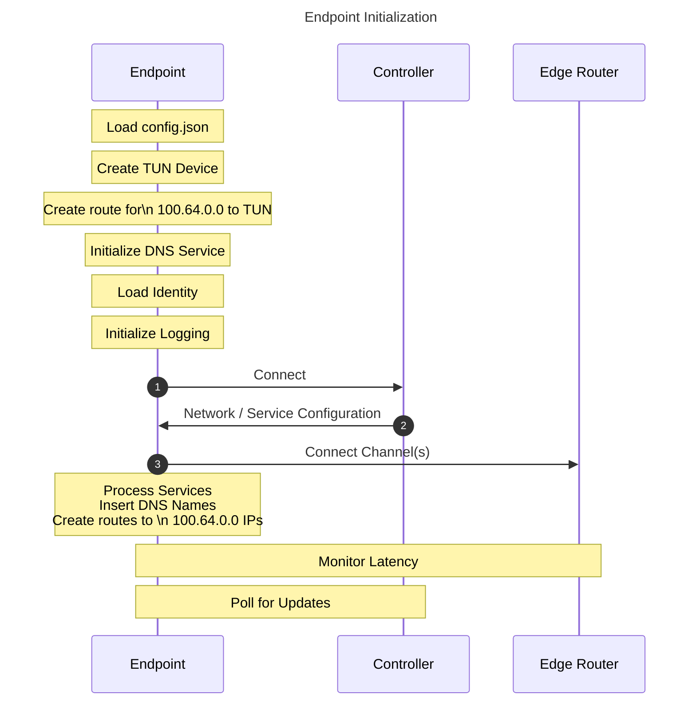

# Endpoint initialization

## Steps

1. Load `config.json`.
2. Create TUN device.
3. Create route for 100.64.0.0 network to TUN.
4. Initialize DNS service.
5. Load identity.
6. Initialize logging.
7. Connect to controller.
8. Download network configuration.
9. Initialize channels to edge routers.
10. Initialize services.
    1. Insert DNS names.
    2. Create routes for IPs to 100.64.0.0 block.
11. Collect latency information for edge router selection.
12. Complete DNS initialization with service names.
13. Periodically check for updates to services or other network config. Polling is controlled by the app
    (including desktop edge clients and tunnelers) at an interval of 10 or 15 seconds in OpenZiti released software.
14. Update services, add or delete edge routers, and so on, as necessary.
